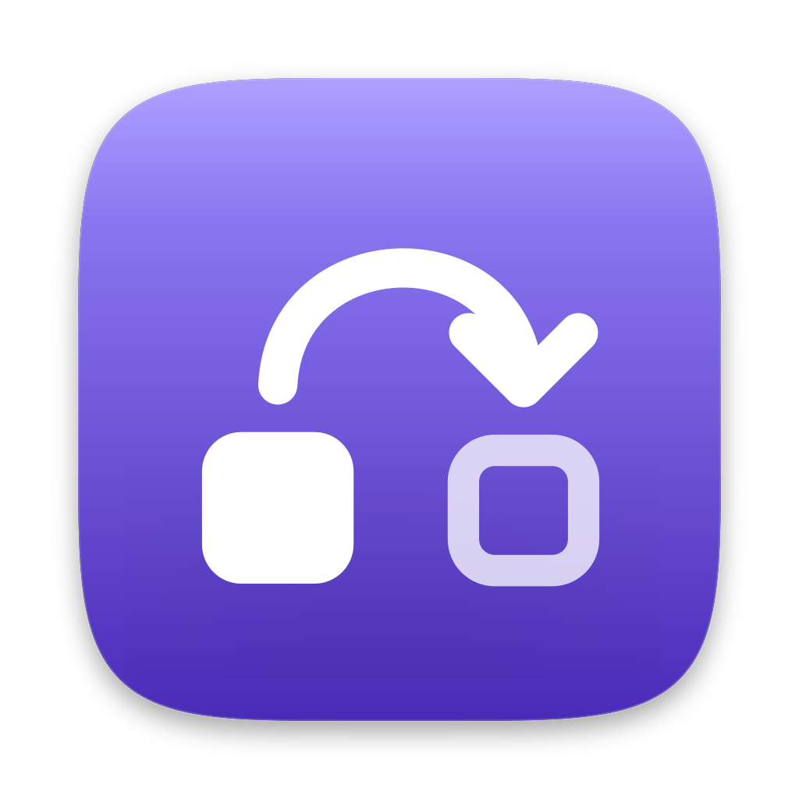
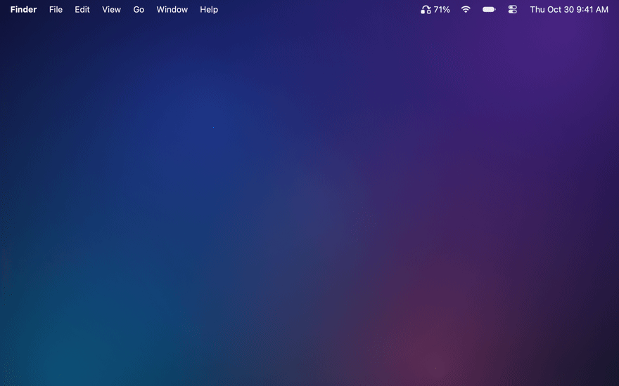
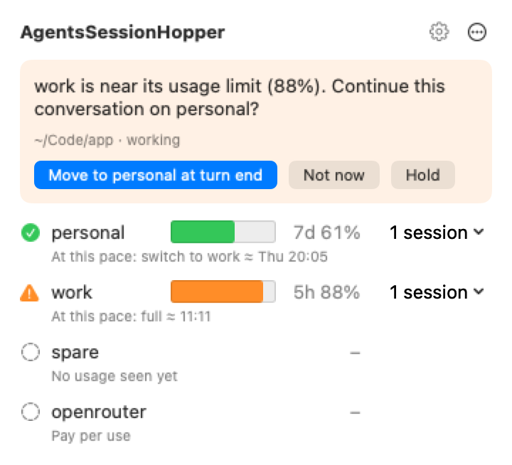
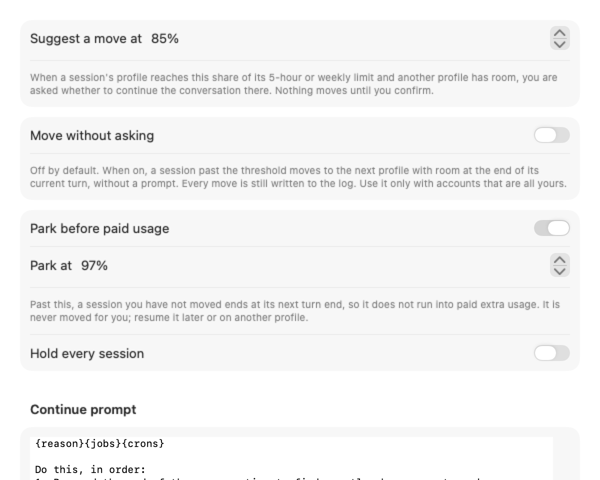

<div align="center">



# AgentsSessionHopper

### Profiles for Claude Code. One conversation, any of your accounts.

Keep your own Claude accounts side by side. When one runs low, continue the same conversation on
another with one click. Nothing lost, nothing re-explained, and nothing moves until you say so.

[](https://www.apple.com/macos/)
[](https://swift.org)
[](#requirements)
[](https://github.com/roypadina/AgentsSessionHopper/releases/latest)
[](https://github.com/roypadina/homebrew-tap)
[](https://github.com/roypadina/AgentsSessionHopper/actions/workflows/ci.yml)
[](https://apps.roypadina.synology.me/apps/agents-session-hopper/)
[](LICENSE)
[](https://ko-fi.com/roypadina)
[](CONTRIBUTING.md)

```bash
brew install --cask roypadina/tap/agents-session-hopper
```





</div>

> AgentsSessionHopper is an independent open-source tool. It is not made by, affiliated with, or
> endorsed by Anthropic. Claude and Claude Code are trademarks of Anthropic, PBC.

## Features

- **Profiles.** Each of your accounts gets its own Claude Code configuration folder, the way
  [Claude Code documents running several accounts](https://code.claude.com/docs/en/authentication).
  Existing `~/.claude` and `~/.claude-*` folders are picked up; new ones are created with your
  setup and history shared, and logged in through Claude Code's own `claude auth login`.
- **Live usage per account**, from what Claude Code reports to its own status line (5-hour and weekly
  windows). Your own status line keeps working. The menu-bar window shows one row per profile with a
  usage bar and what comes next: when it switches at the current pace, when a full profile is free
  again, or that it is ready. Each row's sessions sit in a menu with their moves and Hold.
- **You confirm every move.** At 85% (adjustable), when another profile has room, a notification and
  the menu bar ask: *"work is near its usage limit (88%). Continue this conversation on personal?"*
  Confirm, and the session moves when the current turn ends, resuming the same conversation.
- **Limit stops ask too.** If Claude Code stops on a usage limit, you are asked whether to continue on
  another profile, and the work picks up where it stopped.
- **Park before paid usage** (on by default). Past 97% with nothing confirmed, the session ends at its
  next turn end instead of running into paid extra usage, then waits for the usage window to reset and
  carries on by itself (or tells you how to resume it when no reset time is known).
- **Move without asking** — optional, off by default, explained in Settings.
- **Switch log** of every suggestion, move, park and limit stop (90 days), browsable in Settings → Log or
  from the right-click and ⋯ menus (Show Hand-off Log).
- **Hard to lose.** Open the app again from Applications or Raycast and Settings appears, even when a full
  menu bar hides the icon. Record a global keyboard shortcut in Settings → General to open the window
  from any app. The icon's tooltip and VoiceOver label read the fullest profile's usage.
- **A summary when a session ends:** its name, what it is about, your last three prompts, how it
  ended, when it started and was last used, its folder and the resume command.
- **A CLI** (`sessionhopper`) that does all of it from the terminal, plus a shim for cmux and IDEs.

<div align="center">

</div>

## Requirements

macOS 14 Sonoma or later · Apple Silicon and Intel (universal binary) ·
[Claude Code](https://code.claude.com/docs) **2.1.145 or newer** installed, with a Pro or Max plan per
account (usage numbers come only for those). Any terminal and any shell: nothing depends on cmux or a
particular shell setup.

**Linux (x86_64):** the `sessionhopper` CLI only, no menu-bar app. Built for servers that run
`claude -p`; see [Servers, bots and Linux](#servers-bots-and-linux).

## Install

```bash
brew install --cask roypadina/tap/agents-session-hopper
```

This installs the app and links the `sessionhopper` command.

**Not notarized.** AgentsSessionHopper is self-signed (no paid Apple Developer ID), so macOS may block the
first launch. Open **System Settings → Privacy & Security**, scroll down and click **Open Anyway**, or
clear quarantine once (this also unblocks the bundled CLI):

```bash
xattr -dr com.apple.quarantine /Applications/AgentsSessionHopper.app
```

## Set up

Open the app. On first launch a **Welcome** window explains what it does, where its icon is and how to
start Claude Code with it, and has an **Open at Login** switch (Settings → About → **Welcome Guide…** shows
it again). Its **Set Up Profiles…** button opens the **setup window**, which walks through everything, one
click per step, and shows what each step changes before it does it:

1. **Profiles**: finds your Claude Code folders (`~/.claude`, `~/.claude-*`) or adds new ones, and logs
   each in with Claude Code's own login.
2. **Share history**: links conversation history, todo lists, `/rewind` checkpoints and your
   CLAUDE.md/agents/commands/skills, so a conversation can continue on any profile. Existing folders are
   moved to a backup and merged, never deleted.
3. **Make `claude` use it**: adds one marked alias line to your shell's startup file (zsh, bash, fish or
   tcsh), after a backup. Remove it with one click.
4. **cmux and JetBrains** (optional): a `sessionhopper-shim` link to use as the Claude binary path.
5. **Teach Claude about it**: installs the
   [`agents-session-hopper`](https://github.com/roypadina/padina-claude-code-plugins/tree/main/agents-session-hopper)
   skill into every profile with Claude Code's own `claude plugin install`.
6. **Check**: the same checks as `sessionhopper doctor`.

The same from the terminal: `sessionhopper profiles share <name>`, `sessionhopper shell install`,
`sessionhopper shell link-shim`, `sessionhopper plugin install`, `sessionhopper doctor`. Run setup again any
time from Settings → General.

## Quick start

```bash
sessionhopper profiles import            # find ~/.claude and ~/.claude-* profiles
sessionhopper profiles add work          # new profile: shared history, then Claude Code's own login
sessionhopper doctor                     # claude found, logins, shared history, thresholds

sessionhopper                            # start a session on the first profile with room
sessionhopper -P work "fix the tests"    # start on work; the others stay fallbacks
sessionhopper -c                         # continue the newest session in this folder
sessionhopper --resume                   # pick one from a numbered list (names included)
sessionhopper switch                     # inside a session: move at turn end
sessionhopper status                     # profiles, usage, live sessions
```

Inside Claude Code you can also type `! sessionhopper switch`, or ask the agent to run it.
To supervise every interactive `claude` without the setup window: `sessionhopper shell install` (or add
`alias claude='sessionhopper shim'` to your shell's startup file yourself); for cmux or JetBrains,
`sessionhopper shell link-shim` and use `~/.local/bin/sessionhopper-shim` as the Claude binary path.

**Only sessions started through `sessionhopper` can move.** A `claude` that is already running, or one
started some other way, stays on its account; `install-hooks` alone only records limit stops. Restart
open sessions once: `/exit`, then `sessionhopper -c` in the same folder (or `sessionhopper --resume <id>`).
Terminals that **restore** sessions (cmux, tmux-resurrect, iTerm arrangements) re-run the command each
pane was first opened with, so restart those panes once too. The alias covers interactive shells only;
scripts and cron jobs still run plain `claude`.
Details in the [wiki](https://github.com/roypadina/AgentsSessionHopper/wiki).

## OpenRouter as a last fallback

An OpenRouter profile runs the same unmodified `claude` against [OpenRouter](https://openrouter.ai)
with your own OpenRouter API key, through Claude Code's documented
[gateway settings](https://code.claude.com/docs/en/llm-gateway). It is pay per use, so it is used only
when no Claude profile has room, and a session on it is offered the way back as soon as one has.

In the app: **Settings → Profiles → Add Profile… → OpenRouter key**. From the terminal:

```bash
sessionhopper profiles add openrouter --openrouter \
  --model opus=anthropic/claude-opus-5 --model sonnet=anthropic/claude-sonnet-5
sessionhopper profiles key openrouter < ~/Downloads/openrouter-key.txt
sessionhopper doctor
```

- **The key** never goes on a command line or into `config.json`. On macOS it is a Keychain item
  (service `agents-session-hopper`, account = the profile name). On Linux it is the systemd credential
  `$CREDENTIALS_DIRECTORY/<profile>` when the service has one (`LoadCredential=`), else
  `~/.config/agents-session-hopper/<profile>.key`, which must be private (mode 600).
  `--key-file <path>` sets your own file instead. The key is handed only to the `claude` it launches.
- **`--model alias=name`** maps Claude Code's aliases to OpenRouter model names (sets
  `ANTHROPIC_DEFAULT_<ALIAS>_MODEL`, and `--model opus` becomes the mapped name).
- **When the key runs out of credit** (HTTP 402), the profile counts as full until the next daily reset
  (00:00 UTC). `--resets weekly|monthly` if your key's limit resets less often.
- **Priorities.** Each profile has a priority, lower = preferred (Claude 1, OpenRouter 10 by default):
  `sessionhopper profiles priority <name> <n>`. A better priority with room always wins, and a session on a
  worse one moves back up as soon as a better one is free (with "move without asking" on; else you are
  asked). Profiles of equal priority never trade places before the current one reaches its limit. Example:
  `claude1` and `claude2` at 1, `claude3` at 2, OpenRouter at 10.
- **When OpenRouter is used** is a setting: `sessionhopper config gateway last` (default: only after every
  Claude subscription is full), `order` (by its place in the profile list) or `manual` (only when you ask
  for it: `-P openrouter --only`, `switch openrouter`). Under `last` and `manual`, `-P openrouter`
  without `--only` still starts on a Claude profile with room.
- A revoked or wrong key makes `claude` retry for minutes before it fails. `CLAUDE_CODE_MAX_RETRIES=2` in
  the caller's environment shortens that.

## The VS Code extension

Set the official Claude Code extension's **Claude Process Wrapper** to `sessionhopper` (VS Code settings
→ `claudeCode.claudeProcessWrapper`, e.g. `/opt/homebrew/bin/sessionhopper`; Linux: the full path of the
binary). Every side-panel conversation then runs as a supervised session:

- It starts on the profile the rules pick (priorities, thresholds, OpenRouter last) and shows in
  `sessionhopper status`, the menu-bar app and the log, with live usage.
- When a turn hits a usage limit, the conversation moves to the next profile and the same message runs
  again there; the panel just shows the answer.
- At a turn end (or while idle) it moves like a terminal session: "move without asking", a better
  priority freeing up, or `sessionhopper switch` / the app's Move. `sessionhopper hold` works too.
- A move restarts Claude Code behind the panel: background tasks still running in that conversation
  stop with it.

## Servers, bots and Linux

`sessionhopper run` is for callers that run one non-interactive turn at a time (`claude -p`), such as a
chat bot under systemd. It picks the profile, runs the turn, and when the turn fails on a usage limit it
runs the same turn again on the next profile: Claude profiles in order, OpenRouter last.

```bash
# instead of: claude -p --session-id <uuid> --model opus < prompt.txt
sessionhopper run -- -p --session-id <uuid> --model opus --permission-mode bypassPermissions < prompt.txt
sessionhopper run -- -p --resume <uuid> --model opus --permission-mode bypassPermissions < prompt.txt
```

- Everything after `--` goes to `claude` unchanged. Output is what `claude` would print for your
  `--output-format` (text, json or stream-json); the exit code is `claude`'s.
- Usage comes from `claude`'s own `rate_limit_event` output (it runs with `--output-format
  stream-json` and translates back), so `status` shows real numbers without a status line.
- A retry of a `--session-id` turn continues the same conversation with `--resume`. Every profile must
  share one `projects/` folder (`profiles add` does this; `doctor` checks).
- **Exit 75** means no profile can take the turn right now; stderr names the first reset.
- **Several Claude accounts on a server.** Claude Code ranks `CLAUDE_CODE_OAUTH_TOKEN` above the login in
  a profile's folder, so a token in the service's environment would run every profile on one account.
  `sessionhopper` keeps that token for the first Claude profile only and never gives it to OpenRouter.
  Give each other profile its own `claude setup-token` with `sessionhopper profiles key <name> < file`
  (or log it in inside its folder); `doctor` shows which one each profile uses.
- **Notify on a switch:** `sessionhopper config on-switch "<command>"` runs the command, not waited for,
  on every move, limit stop and park, with `SESSIONHOPPER_EVENT`, `SESSIONHOPPER_FROM`, `SESSIONHOPPER_TO`,
  `SESSIONHOPPER_REASON`, `SESSIONHOPPER_DETAIL` and `SESSIONHOPPER_SESSION` set. `off` removes it.
- On Linux a killed `sessionhopper` (a caller's timeout) takes the running `claude` with it.

**Linux install** (x86_64, any glibc distribution; the Swift runtime is built in):

```bash
curl -LO https://github.com/roypadina/AgentsSessionHopper/releases/latest/download/sessionhopper-linux-x86_64.tar.gz
tar -xzf sessionhopper-linux-x86_64.tar.gz
install -Dm755 sessionhopper-linux-x86_64/sessionhopper ~/.local/bin/sessionhopper
sessionhopper profiles import && sessionhopper doctor
```

State lives in `${XDG_STATE_HOME:-~/.local/state}/agents-session-hopper/`. A systemd service needs no
change other than calling `sessionhopper run --` where it called `claude`; give it the OpenRouter key
with `LoadCredential=openrouter:/path/to/key` (the credential name is the profile name).

## How it works (and what it never does)

- `sessionhopper` starts the **official, unmodified `claude`** with the profile's configuration folder
  and `--settings` that add a status line and a few hooks for that session only. No settings file is
  written. Claude Code's traffic is never changed, proxied or inspected.
- **Usage** comes only from the documented
  [status-line input](https://code.claude.com/docs/en/statusline) (`rate_limits`), and limit stops
  from the documented [`StopFailure` hook](https://code.claude.com/docs/en/hooks) (`error: "rate_limit"`).
- **A move** waits until the turn and any background jobs finish (the hooks and the conversation
  transcript must both agree), then restarts `claude --resume <id>` under the next profile. An idle
  session comes back silently; one that was cut off gets a short continue prompt, which you can replace
  with your own (`sessionhopper config prompt`). Moving needs every profile to share one `projects/` folder, where Claude Code
  keeps conversations. Profiles added by the app do; `doctor` checks.
- **It never reads, copies or sends** your Claude login or Claude Code's Keychain items. Login always
  happens in Claude Code's own flow. The only secrets it handles are ones you give it with `sessionhopper
  profiles key`: an OpenRouter key, or on a server a `claude setup-token` for a profile. Each is kept in
  its own Keychain item (macOS) or a private file (Linux) and handed only to that profile's `claude`.
- **It makes no network requests** at all: no usage endpoint, no telemetry, no update check. (The
  optional skill install runs Claude Code's own `claude plugin install`, which downloads it from GitHub.)
- **It does not change or get around any account's limits.** Each account keeps its own; you decide
  when a conversation continues elsewhere.

**Your part:** use it only with accounts that are yours, never shared with anyone. Each account is
subject to Anthropic's Consumer Terms, Usage Policy and Claude Code usage rules, which Anthropic may
change at any time. If you run it for a bot or service, check Anthropic's terms for your use case.

## Privacy

No network access, no analytics. State lives in `~/Library/Application Support/AgentsSessionHopper/`
(Linux: `~/.local/state/agents-session-hopper/`)
(profile list, last-known usage percentages, the switch log). Preferences are in the defaults domain
`com.padina.agents-session-hopper`. Optional `install-hooks` edits a profile's `settings.json` only when
you run it, keeps a backup, and `uninstall-hooks` restores it.

## Build from source

Requires Xcode or the Xcode command line tools (Swift 6).

```bash
git clone https://github.com/roypadina/AgentsSessionHopper.git
cd AgentsSessionHopper
swift test                        # unit + integration tests (fake `claude`, no real sessions)
Scripts/package_app.sh            # dist/AgentsSessionHopper.app, CLI in Contents/Helpers/
Scripts/package_linux.sh          # dist/sessionhopper-linux-x86_64.tar.gz, built in Docker (swift:6.4)
```

On Linux itself: `swift test` and `swift build -c release --static-swift-stdlib --product sessionhopper`.

Live tests with the real `claude` (a few cents of usage; temp state, your own config untouched). Usage is
mocked with `SESSIONHOPPER_MOCK_LIMITS=<dir>` (`<dir>/<profile>.limits.json` overrides what sessions
report), so every hand-off can be forced:

```bash
swift build
Scripts/live/run-swaps.sh ~/.claude ~/.claude-work [--openrouter-key-file F]          # `run`, headless
Scripts/live/interactive-swaps.py ~/.claude ~/.claude-work [--openrouter-key-file F]  # a real TUI session
```

See [CONTRIBUTING.md](CONTRIBUTING.md).

## Uninstall

```bash
sessionhopper uninstall-hooks --profile <name>   # only if you ran install-hooks
brew uninstall --zap --cask agents-session-hopper
```

Your Claude Code profiles and conversations are untouched.

## Companion app

[Agents Monitor](https://github.com/roypadina/AgentsMonitor) watches usage limits for Claude Code and
Codex accounts from the menu bar. The two apps are independent.

## Feature requests and contributions

Have an idea for AgentsSessionHopper? [Request a feature](https://github.com/roypadina/AgentsSessionHopper/issues/new?template=feature_request.yml) and say what you're trying to do; that matters more than the exact feature. Found a bug? [Report it](https://github.com/roypadina/AgentsSessionHopper/issues/new?template=bug_report.yml).

Code is welcome too: small, focused pull requests, and an issue first for anything bigger. See [CONTRIBUTING.md](CONTRIBUTING.md).

Tipped on [Ko-fi](https://ko-fi.com/roypadina)? Add your Ko-fi name to the request and it goes to the front of my queue. It's a thank-you, not a purchase: no promise on what ships or when.

## More Mac apps by Roy

Free, open-source Mac menu-bar apps and terminal tools, all on one site: **[apps.roypadina.synology.me](https://apps.roypadina.synology.me/)**.

- [Agents Monitor](https://apps.roypadina.synology.me/apps/agents-monitor/) — See your Claude Code and Codex usage limits before you hit them.
- [agentctl](https://apps.roypadina.synology.me/apps/agentctl/) — Find and resume any Claude Code or Codex session from one terminal menu.
- [claude-jam](https://apps.roypadina.synology.me/apps/claude-jam/) — Share one real Claude Code session with other humans.

## Support

If this app saves you time, a coffee keeps the next one coming:

[](https://ko-fi.com/roypadina)

## License

MIT © Roy Padina
