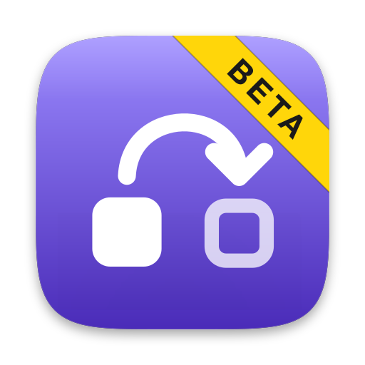
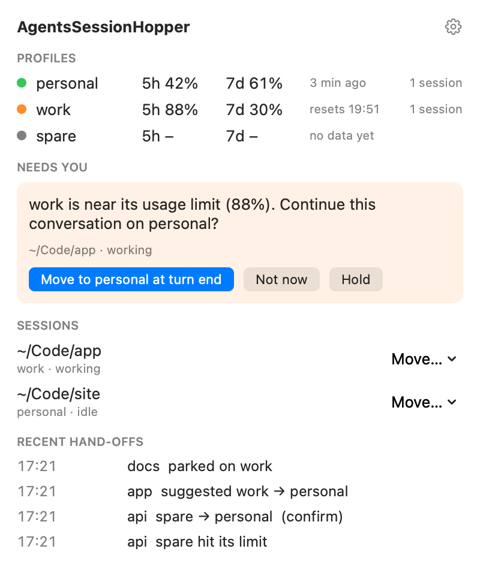
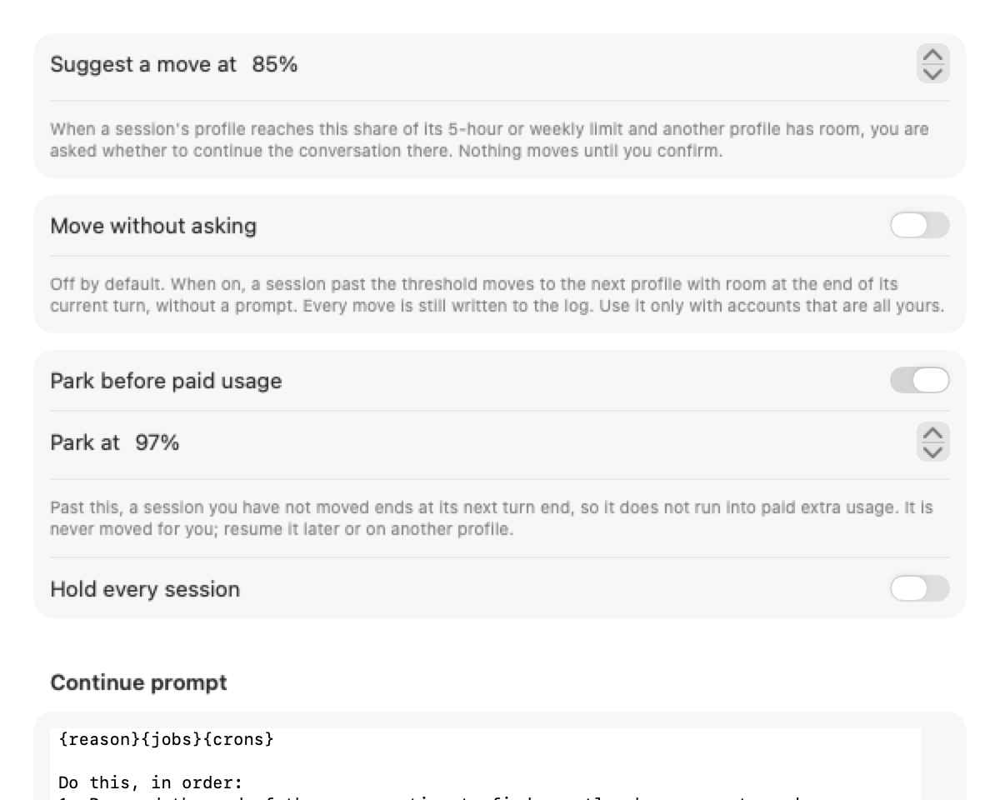

<div align="center">



# AgentsSessionHopper

**⚠️ BETA — not fully tested; real account hand-offs are new. Expect rough edges; please [report issues](https://github.com/roypadina/AgentsSessionHopper/issues).**

### Profiles for Claude Code. One conversation, any of your accounts.

Keep your own Claude accounts side by side. When one runs low, continue the same conversation on
another with one click. Nothing lost, nothing re-explained, and nothing moves until you say so.

[](https://www.apple.com/macos/)
[](https://swift.org)
[](#requirements)
[](https://github.com/roypadina/AgentsSessionHopper/releases/latest)
[](https://github.com/roypadina/homebrew-tap)
[](https://github.com/roypadina/AgentsSessionHopper/actions/workflows/ci.yml)
[](https://apps.roypadina.synology.me/apps/agents-session-hopper/)
[](LICENSE)
[](docs/ROADMAP.md)
[](https://ko-fi.com/roypadina)
[](CONTRIBUTING.md)

```bash
brew install --cask roypadina/tap/agents-session-hopper
```



</div>

> AgentsSessionHopper is an independent open-source tool. It is not made by, affiliated with, or
> endorsed by Anthropic. Claude and Claude Code are trademarks of Anthropic, PBC.

## Features

- **Profiles.** Each of your accounts gets its own Claude Code configuration folder, the way
  [Claude Code documents running several accounts](https://code.claude.com/docs/en/authentication).
  Existing `~/.claude` and `~/.claude-*` folders are picked up; new ones are created with your
  setup and history shared, and logged in through Claude Code's own `claude auth login`.
- **Live usage per account**, from what Claude Code reports to its own status line (5-hour and weekly
  windows). Your own status line keeps working.
- **You confirm every move.** At 85% (adjustable), when another profile has room, a notification and
  the menu bar ask: *"work is near its usage limit (88%). Continue this conversation on personal?"*
  Confirm, and the session moves when the current turn ends, resuming the same conversation.
- **Limit stops ask too.** If Claude Code stops on a usage limit, you are asked whether to continue on
  another profile, and the work picks up where it stopped.
- **Park before paid usage** (on by default). Past 97% with nothing confirmed, the session ends at its
  next turn end instead of running into paid extra usage, and tells you how to resume it.
- **Move without asking** — optional, off by default, explained in Settings.
- **Switch log** of every suggestion, move, park and limit stop (90 days), browsable in Settings.
- **A CLI** (`sessionhopper`) that does all of it from the terminal, plus a shim for cmux and IDEs.

<div align="center">

</div>

## Requirements

macOS 14 Sonoma or later · Apple Silicon and Intel (universal binary) ·
[Claude Code](https://code.claude.com/docs) **2.1.145 or newer** installed, with a Pro or Max plan per
account (usage numbers come only for those). Any terminal and any shell: nothing depends on cmux or a
particular shell setup.

## Install

```bash
brew install --cask roypadina/tap/agents-session-hopper
```

This installs the app and links the `sessionhopper` command.

**Not notarized.** AgentsSessionHopper is self-signed (no paid Apple Developer ID), so macOS may block the
first launch. Open **System Settings → Privacy & Security**, scroll down and click **Open Anyway**, or
clear quarantine once (this also unblocks the bundled CLI):

```bash
xattr -dr com.apple.quarantine /Applications/AgentsSessionHopper.app
```

## Quick start

```bash
sessionhopper profiles import            # find ~/.claude and ~/.claude-* profiles
sessionhopper profiles add work          # new profile: shared history, then Claude Code's own login
sessionhopper doctor                     # claude found, logins, shared history, thresholds

sessionhopper                            # start a session on the first profile with room
sessionhopper -P work "fix the tests"    # start on work; the others stay fallbacks
sessionhopper -c                         # continue the newest session in this folder
sessionhopper --resume                   # pick one from a numbered list (names included)
sessionhopper switch                     # inside a session: move at turn end
sessionhopper status                     # profiles, usage, live sessions
```

Inside Claude Code you can also type `! sessionhopper switch`, or ask the agent to run it.
To supervise every interactive `claude`, add `alias claude='sessionhopper shim'` to your shell profile;
for cmux or an IDE, link the CLI as `sessionhopper-shim` and use that as the Claude binary path.

**Only sessions started through `sessionhopper` can move.** A `claude` that is already running, or one
started some other way, stays on its account; `install-hooks` alone only records limit stops. Restart
open sessions once: `/exit`, then `sessionhopper -c` in the same folder (or `sessionhopper --resume <id>`).
Terminals that **restore** sessions (cmux, tmux-resurrect, iTerm arrangements) re-run the command each
pane was first opened with, so restart those panes once too. The alias covers interactive shells only;
scripts and cron jobs still run plain `claude`.
Details in the [wiki](https://github.com/roypadina/AgentsSessionHopper/wiki).

## How it works (and what it never does)

- `sessionhopper` starts the **official, unmodified `claude`** with the profile's configuration folder
  and `--settings` that add a status line and a few hooks for that session only. No settings file is
  written. Claude Code's traffic is never changed, proxied or inspected.
- **Usage** comes only from the documented
  [status-line input](https://code.claude.com/docs/en/statusline) (`rate_limits`), and limit stops
  from the documented [`StopFailure` hook](https://code.claude.com/docs/en/hooks) (`error: "rate_limit"`).
- **A move** waits until the turn and any background jobs finish (the hooks and the conversation
  transcript must both agree), then restarts `claude --resume <id>` under the next profile. An idle
  session comes back silently; one that was cut off gets a short continue prompt, which you can replace
  with your own (`sessionhopper config prompt`). Moving needs every profile to share one `projects/` folder, where Claude Code
  keeps conversations. Profiles added by the app do; `doctor` checks.
- **It never reads, copies, stores or sends** your Claude login, tokens or Keychain items. Login always
  happens in Claude Code's own flow.
- **It makes no network requests** at all: no usage endpoint, no telemetry, no update check.
- **It does not change or get around any account's limits.** Each account keeps its own; you decide
  when a conversation continues elsewhere.

**Your part:** use it only with accounts that are yours, never shared with anyone. Each account is
subject to Anthropic's Consumer Terms, Usage Policy and Claude Code usage rules, which Anthropic may
change at any time.

## Privacy

No network access, no analytics. State lives in `~/Library/Application Support/AgentsSessionHopper/`
(profile list, last-known usage percentages, the switch log). Preferences are in the defaults domain
`com.padina.agents-session-hopper`. Optional `install-hooks` edits a profile's `settings.json` only when
you run it, keeps a backup, and `uninstall-hooks` restores it.

## Build from source

Requires Xcode or the Xcode command line tools (Swift 6).

```bash
git clone https://github.com/roypadina/AgentsSessionHopper.git
cd AgentsSessionHopper
swift test                        # unit + integration tests (fake `claude`, no real sessions)
Scripts/package_app.sh            # dist/AgentsSessionHopper.app, CLI in Contents/Helpers/
```

See [CONTRIBUTING.md](CONTRIBUTING.md).

## Uninstall

```bash
sessionhopper uninstall-hooks --profile <name>   # only if you ran install-hooks
brew uninstall --zap --cask agents-session-hopper
```

Your Claude Code profiles and conversations are untouched.

## Companion app

[Agents Monitor](https://github.com/roypadina/AgentsMonitor) watches usage limits for Claude Code and
Codex accounts from the menu bar. The two apps are independent.

## Feature requests and contributions

Have an idea for AgentsSessionHopper? [Request a feature](https://github.com/roypadina/AgentsSessionHopper/issues/new?template=feature_request.yml) and say what you're trying to do; that matters more than the exact feature. Found a bug? [Report it](https://github.com/roypadina/AgentsSessionHopper/issues/new?template=bug_report.yml). AgentsSessionHopper is in beta, so a bug report counts as much as a feature request.

Code is welcome too: small, focused pull requests, and an issue first for anything bigger. See [CONTRIBUTING.md](CONTRIBUTING.md).

Tipped on [Ko-fi](https://ko-fi.com/roypadina)? Add your Ko-fi name to the request and it goes to the front of my queue. It's a thank-you, not a purchase: no promise on what ships or when.

## More Mac apps by Roy

Free, open-source Mac menu-bar apps and terminal tools, all on one site: **[apps.roypadina.synology.me](https://apps.roypadina.synology.me/)**.

- [Agents Monitor](https://apps.roypadina.synology.me/apps/agents-monitor/) — See your Claude Code and Codex usage limits before you hit them.
- [agentctl](https://apps.roypadina.synology.me/apps/agentctl/) — Find and resume any Claude Code or Codex session from one terminal menu.
- [claude-jam](https://apps.roypadina.synology.me/apps/claude-jam/) — Share one real Claude Code session with other humans.

## Support

If this app saves you time, a coffee keeps the next one coming:

[](https://ko-fi.com/roypadina)

## License

MIT © Roy Padina
