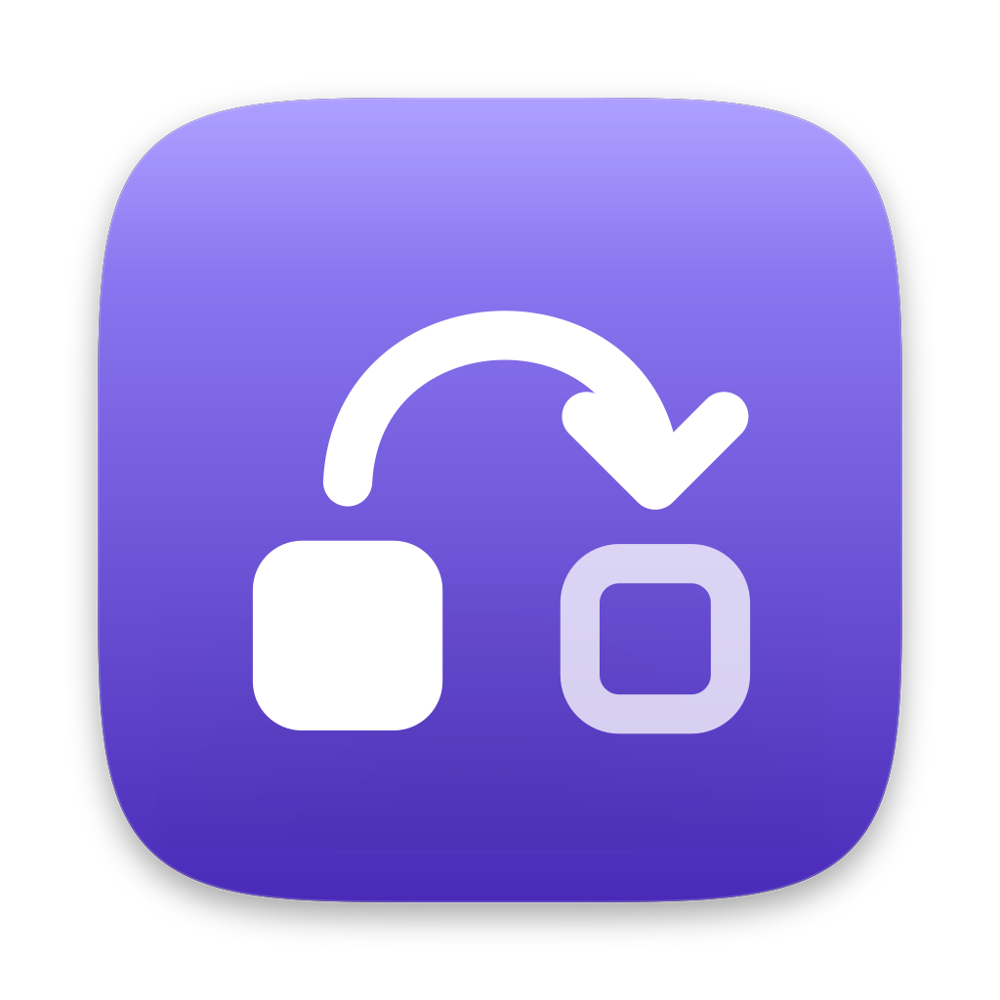

# AgentsSessionHopper

**Profiles for Claude Code.** Keep your own Claude accounts side by side, one Claude Code profile each.
When one runs low, continue the same conversation on another with one click. Nothing moves until you
confirm.

- A **menu-bar app**: usage per profile and when it switches at the current pace, a prompt when a session should move, the switch log, settings, and an optional global shortcut.
- A **CLI**, `sessionhopper`: starts and supervises sessions, and does everything the app does.
- On **Linux** (x86_64): the CLI alone, for servers and bots that run `claude -p`, with an optional
  pay-per-use OpenRouter profile as the last fallback. See [Servers, bots and OpenRouter](Servers-bots-and-OpenRouter).

Start here: [Installation](Installation) → [Getting started](Getting-started).

> AgentsSessionHopper is an independent open-source tool. It is not made by, affiliated with, or
> endorsed by Anthropic. Claude and Claude Code are trademarks of Anthropic, PBC.
>
> It starts the official, unmodified `claude`, never reads, copies or sends your Claude login or Claude Code's Keychain items,
> and makes no network requests of its own besides an opt-in update check against GitHub (a usage refresh runs `claude`, one small request on that account). (A key or setup-token you store for a profile goes only to that profile's `claude`.) Use it only with accounts that are yours, never shared with anyone.
> See [Privacy and terms](Privacy-and-terms).

## Support

If this app saves you time, a coffee on Ko-fi keeps the next one coming.

Once in a while, AgentsSessionHopper asks too. A small receipt card shows up about 10 seconds after you close the menu-bar window, only within 12 hours after a hop kept a conversation going and when nothing needs you: no profile in use is on pace to reach the suggest threshold within the hour, and nothing was logged in the last 2 minutes. It only appears after more than 10 hops (about 3 weeks), and at most 3 times a year. "Ask me in 2 weeks" snoozes it, and "Nope, don't ask again" keeps it away until the next major version, and for at least 90 days. If an AgentsSessionHopper window opens or a session hits a limit while the card is still open, it closes and counts as a snooze; one left unanswered for 5 minutes, or when you step away, fades and counts as a snooze too. It never shows next to a limit or an error, never takes keyboard focus, and its counts stay on your Mac.
