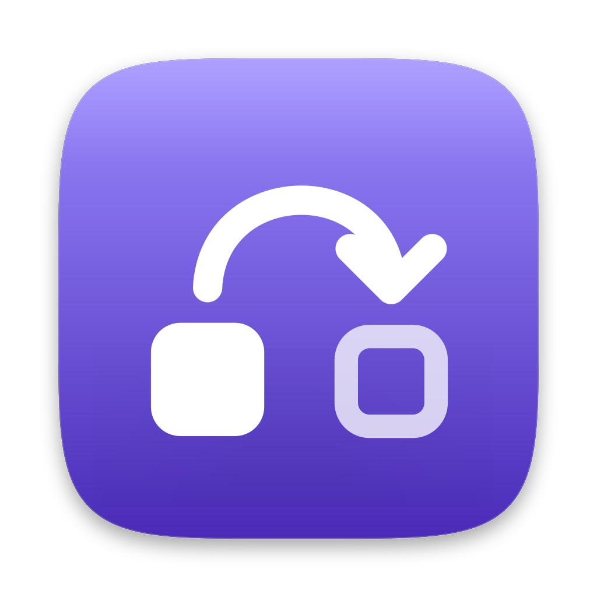

# AgentsSessionHopper

**Profiles for Claude Code.** Keep your own Claude accounts side by side, one Claude Code profile each.
When one runs low, continue the same conversation on another with one click. Nothing moves until you
confirm.

- A **menu-bar app**: usage per profile and when it switches at the current pace, a prompt when a session should move, the switch log, settings, and an optional global shortcut.
- A **CLI**, `sessionhopper`: starts and supervises sessions, and does everything the app does.
- On **Linux** (x86_64): the CLI alone, for servers and bots that run `claude -p`, with an optional
  pay-per-use OpenRouter profile as the last fallback. See [Servers, bots and OpenRouter](Servers-bots-and-OpenRouter).

Start here: [Installation](Installation) → [Getting started](Getting-started).

> AgentsSessionHopper is an independent open-source tool. It is not made by, affiliated with, or
> endorsed by Anthropic. Claude and Claude Code are trademarks of Anthropic, PBC.
>
> It starts the official, unmodified `claude`, never reads, copies or sends your Claude login or Claude Code's Keychain items,
> and makes no network requests of its own besides an opt-in update check against GitHub (a usage refresh runs `claude`, one small request on that account). (A key or setup-token you store for a profile goes only to that profile's `claude`.) Use it only with accounts that are yours, never shared with anyone.
> See [Privacy and terms](Privacy-and-terms).

## Support

If this app saves you time, a coffee on Ko-fi keeps the next one coming.

